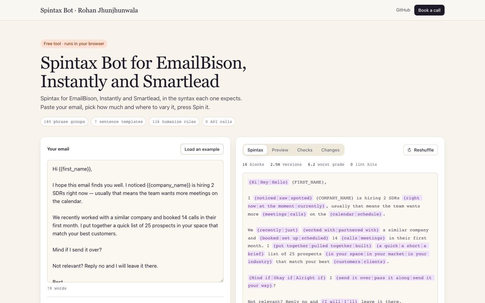

# Spintax Bot

Spintax for cold email, in the exact syntax **EmailBison**, **Smartlead** and **Instantly** expect. Paste an email, pick how much and where to vary it, and get spintax where every combination still reads like a person wrote it.

It runs three ways, and all of them share one engine:

- **Web app.** Open `index.html`. No sign-up, no server; your copy never leaves the page unless you switch on AI mode.
- **Command line.** `node cli/spin.js email.txt --platform smartlead`
- **AI skills.** Install the two included skills in Claude, or paste them into ChatGPT, so the model spins and humanizes copy the same way.

Optional **AI mode**: connect your own Claude or OpenAI API key and the model writes the spintax, while the rule-based engine checks every answer before you see it.

Built by [Rohan Jhunjhunwala](https://www.linkedin.com/in/rohan-jjw/), fractional GTM engineer.



---

## Contents

- [What it does](#what-it-does)
- [Quick start](#quick-start)
- [The 12 functions (with 120 examples)](#the-12-functions)
- [Platform syntax](#platform-syntax)
- [AI mode: bring your own Claude or OpenAI key](#ai-mode-bring-your-own-claude-or-openai-key)
- [Claude and ChatGPT skills](#claude-and-chatgpt-skills)
- [Command line](#command-line)
- [Use it as a library](#use-it-as-a-library)
- [Train it on your own emails](#train-it-on-your-own-emails)
- [Tests](#tests)
- [Project structure](#project-structure)
- [Deploy the web app](#deploy-the-web-app)
- [Security and privacy](#security-and-privacy)

---

## What it does

| | |
| --- | --- |
| **Spins at 50%, 80% or 100%** | How many of the phrases it knows get a spin block. |
| **Word, sentence or mixed** | Swap words inside sentences, offer whole-sentence rewrites, or both. |
| **Never breaks your merge tags** | Variables, the signature tag, links, emails and numbers are locked before spinning and never land inside a block. |
| **Keeps the meaning** | Context guards stop swaps that change what a sentence says. For example "calls go to voicemail" never becomes "meetings go to voicemail". |
| **Humanizes first** | Removes the patterns that make cold email read as AI-written: stock openers, dashes, filler, inflated words and gushing sign-offs. |
| **Converts between platforms** | Turns EmailBison spintax into Instantly spintax (and every other direction), including variables and the signature tag. |
| **Checks 1,000 renders** | Every result is rendered 1,000 times and linted for doubled words, a/an errors, stray punctuation, dashes and spam words. It also reports the worst-case reading grade and the number of unique versions. |
| **Optional AI mode** | Your own Claude or OpenAI key writes the spintax; the engine validates it and falls back to its own version if the AI breaks a rule. |

The knowledge base is built in: about 180 phrase groups, sentence templates for calls to action, opt-outs, bumps and sign-offs, context guards, and 110+ humanize rules. Without AI mode it makes **zero API calls**.

---

## Quick start

### Web app

1. Download or clone this repo.
2. Double-click `index.html`. It opens in your browser and works offline.
3. Paste your email, pick the platform, intensity and mode, then press **Spin it** (or `Cmd/Ctrl + Enter`).
4. Check the **Preview** tab for random versions and the **Checks** tab for the lint results, then press **Copy spintax** (or **Copy as HTML** for rich-text editors).

### Command line (Node 18+)

```bash
git clone https://github.com/rohanjjwala/spintax-bot.git
cd spintax-bot
node cli/spin.js examples/inputs/clean/01-saas-hiring-signal.txt --platform smartlead --intensity 80 --mode word --renders 2
```

No `npm install` needed: there are no dependencies.

### Claude or ChatGPT

See [Claude and ChatGPT skills](#claude-and-chatgpt-skills) below, or the full guide in [`docs/using-the-skills.md`](docs/using-the-skills.md).

---

## The 12 functions

Each function has **10 worked examples**, generated by the engine from the emails in `examples/inputs/` and checked automatically (1,000 renders each, 0 lint hits, spintax parses back cleanly). They double as the training set for the skills and for AI mode.

| # | Function | What it does | Examples |
| --- | --- | --- | --- |
| 1 | Word-level, 50% | Swaps about half of the words and phrases it knows, inside each sentence | [01-word-50.md](examples/01-word-50.md) |
| 2 | Word-level, 80% | Swaps most of them. A good default for lists over 2,000 | [02-word-80.md](examples/02-word-80.md) |
| 3 | Word-level, 100% | Swaps every phrase it knows, with up to four options | [03-word-100.md](examples/03-word-100.md) |
| 4 | Sentence-level, 50% | Whole-sentence rewrites for about half of the sentences | [04-sentence-50.md](examples/04-sentence-50.md) |
| 5 | Sentence-level, 80% | Whole-sentence rewrites for most sentences | [05-sentence-80.md](examples/05-sentence-80.md) |
| 6 | Sentence-level, 100% | Whole-sentence rewrites wherever it is safe | [06-sentence-100.md](examples/06-sentence-100.md) |
| 7 | Mixed, 50% | Word swaps in the body, sentence blocks for the CTA, opt-out and sign-off | [07-mixed-50.md](examples/07-mixed-50.md) |
| 8 | Mixed, 80% | Same, with more blocks | [08-mixed-80.md](examples/08-mixed-80.md) |
| 9 | Mixed, 100% | Same, at maximum variation | [09-mixed-100.md](examples/09-mixed-100.md) |
| 10 | Humanize | Cleans AI-sounding copy without spinning it | [10-humanize.md](examples/10-humanize.md) |
| 11 | Humanize, then spin | The web app's default: clean first, then spin | [11-humanize-then-spin.md](examples/11-humanize-then-spin.md) |
| 12 | Convert | Moves existing spintax between EmailBison, Smartlead and Instantly | [12-convert.md](examples/12-convert.md) |

**Which one should I use?**

- Most campaigns: **word-level, 80%, with Humanize on.**
- Big lists or many inboxes, where you need more unique versions: **mixed, 100%.**
- Short follow-ups: **sentence-level, 50%.** Fewer, bigger differences read more naturally in three-line emails.
- Moving a campaign to another tool: **convert.**

Example (word-level, 80%, Smartlead):

```text
I {noticed|saw|spotted} {{company_name}} is hiring 2 SDRs {right now|at the moment|currently}. {Usually|Often|Typically} that means the team wants more {meetings|calls} on the calendar, {fast|quickly}.
```

---

## Platform syntax

| | EmailBison | Smartlead | Instantly |
| --- | --- | --- | --- |
| Spin block | `{Hi\|Hey\|Hello}` | `{Hi\|Hey\|Hello}` | `{{RANDOM \| Hi \| Hey \| Hello}}` |
| Variables | `{FIRST_NAME}` | `{{first_name}}` | `{{firstName}}` |
| Inline fallback | not supported | not supported | `{{firstName\|there}}` |
| Signature | `{SENDER_EMAIL_SIGNATURE}` | `%signature%` | `{{accountSignature}}` |

With **Match variable syntax** on (the default), the bot rewrites your variables and signature tag into the syntax of the platform you pick. Fallbacks are kept for Instantly and dropped, with a note, for the other two.

---

## AI mode: bring your own Claude or OpenAI key

The rule-based engine is fast, free and predictable. A large language model writes more varied, more natural options. AI mode gives you both: **the model writes, and the engine checks.**

**How it works**

1. Your email, your settings and two worked examples for the same function (from `examples/`) go to the model, together with the platform rules.
2. The model returns spintax.
3. The engine converts any syntax slips for your platform, parses the result and runs the same 1,000-render checks.
4. If the model broke a hard rule (a merge tag inside a block, nested or unclosed braces, a dash, no blocks), the engine sends the errors back once for a fix.
5. If it still fails, you get the engine's own version, with a note saying why.

**In the web app**

1. Open **AI mode** under the toggles.
2. Turn on **Write with AI** and pick **Claude** or **OpenAI**.
3. Paste your API key. Tick **Remember on this device** only if you want it saved in this browser.
4. Press **Spin it**. The stats line shows which model wrote it and that the bot checked it.

**From the command line**

```bash
export ANTHROPIC_API_KEY=sk-ant-...      # or: export OPENAI_API_KEY=sk-...
node cli/spin.js email.txt --platform instantly --mode mixed --ai claude
node cli/spin.js email.txt --ai openai --model gpt-5
```

**Getting a key**

- Claude: [console.anthropic.com](https://console.anthropic.com/) → **API Keys** → **Create Key**.
- OpenAI: [platform.openai.com/api-keys](https://platform.openai.com/api-keys) → **Create new secret key**.

You pay the provider for what you use. A single email is a few thousand tokens.

**Models**

| Provider | Default | Others listed | Notes |
| --- | --- | --- | --- |
| Claude | `claude-opus-5-5` | `claude-sonnet-5-5`, `claude-haiku-5-5` | Opus and Sonnet requests opt into server-side refusal fallback |
| OpenAI | `gpt-5` | `gpt-5-mini` | Any chat-completions model ID can be typed in |

The model field accepts any model ID, so newer models work without a code change.

---

## Claude and ChatGPT skills

Two skills live in [`skills/`](skills/):

| Skill | What it teaches the model |
| --- | --- |
| [`cold-email-spintax`](skills/cold-email-spintax/) | Every function: platforms, intensities, modes, conversion, the hard rules, a self-check, and all 120 examples as references |
| [`cold-email-humanizer`](skills/cold-email-humanizer/) | The catalogue of AI tells in cold email, with plain replacements and before-and-after rewrites |

**Claude Code:** copy both folders into `~/.claude/skills/`, then ask *"Spin this for Smartlead, 80%, word-level"* or *"Humanize this email"*.

**Claude.ai and Claude Desktop:** zip each skill folder and upload it under **Settings → Capabilities → Skills**.

**ChatGPT:** create a Custom GPT, paste [`prompts/chatgpt-instructions.md`](prompts/chatgpt-instructions.md) into **Instructions**, and upload `examples/examples.json` plus the skill reference files as **Knowledge**.

Step-by-step instructions, example prompts for every function, and how to add your own examples: **[`docs/using-the-skills.md`](docs/using-the-skills.md)**.

---

## Command line

```text
node cli/spin.js [file] [options]

  --platform  bison | smartlead | instantly      (default: smartlead)
  --intensity 50 | 80 | 100                      (default: 80)
  --mode      word | sentence | mixed            (default: word)
  --no-humanize                                  skip the humanize pass
  --no-convert                                   keep variables as written
  --convert-only                                 only convert existing spintax and variables to --platform
  --humanize-only                                only run the humanizer, no spin
  --renders N                                    also print N random versions
  --seed N                                       change the random picks
  --json                                         print everything as JSON
  --ai claude | openai                           let your own model write the spintax
  --model ID                                     model to use with --ai
```

The spintax goes to stdout and the checks go to stderr, so `> out.txt` saves only the spintax. Reads from stdin when no file is given:

```bash
pbpaste | node cli/spin.js --platform bison --mode mixed | pbcopy
```

---

## Use it as a library

```js
const Spintax = require("./src/spintax.js");

const res = Spintax.build(emailText, {
  platform: "smartlead",   // "bison" | "smartlead" | "instantly"
  intensity: 0.8,          // 0.5 | 0.8 | 1
  mode: "word",            // "word" | "sentence" | "mixed"
  humanize: true,
  convert: true,           // rewrite variables for the platform
  seed: 1,
});

Spintax.serialize(res);                      // the spintax string
Spintax.toHTML(res);                         // paragraph HTML in the platform's editor format
Spintax.render(res, Spintax.rng(7));         // one random version
Spintax.check(res, 1000);                    // { blocks, combos, lint, worst, spam, words, dashes }
Spintax.humanize(text);                      // { text, changes }
Spintax.convertSyntax(spintax, "instantly"); // { text, log }
Spintax.parse(spintax, "bison");             // { res, errors }: validate spintax from anywhere
```

In the browser the same API is on `window.Spintax`, and AI mode is on `window.SpintaxAI`.

---

## Train it on your own emails

The engine learns nothing by itself; you shape it in three places.

**1. Add your own examples** (improves the skills and AI mode)

1. Put your best-performing emails in `examples/inputs/clean/` (one `.txt` per email). Put AI-sounding drafts you want cleaned in `examples/inputs/ai-drafts/`.
2. Run `node scripts/generate-examples.js`. It rebuilds all 12 example files, `examples.json` and the browser copy, and fails loudly if any example has a lint hit.
3. Copy the regenerated `examples/*.md` into `skills/cold-email-spintax/references/examples/` so the skill sees them too.

**2. Extend the phrase bank** (`src/spintax.js`)

- `GROUPS`: phrases that can safely replace each other, for example `["noticed", "saw", "spotted"]`.
- `CONTEXT`: guards for words that only swap safely in some positions. The third element checks the text before the word: `"calls"` only swaps after "booked", "more" or a number.
- `INTENTS`: sentence templates for calls to action, opt-outs, bumps and sign-offs.

**3. Extend the humanizer** (`HUMANIZE` in `src/spintax.js`)

Each rule is `[regex, replacement, label]`. Put phrase-level rules before single-word rules.

After any change, run `npm test`.

---

## Tests

```bash
npm test
```

This runs two things:

- **`test/harness.js`:** 10 hard inputs (merge tags in every syntax, fallbacks, links, existing spintax, unclosed braces, AI-sounding copy) × 3 platforms × 3 modes × 3 intensities × humanize on/off. That is 540 builds, each with 1,000 linted renders. It asserts balanced braces, no variable inside a block, every merge tag kept, no dashes and valid Instantly syntax.
- **`scripts/generate-examples.js`:** regenerates the 120 examples and fails if any of them has a lint hit or does not parse back.

---

## Project structure

```text
.
├── index.html                 Web app (open directly, or host anywhere static)
├── src/
│   ├── spintax.js             The engine: knowledge base, build, humanize, convert, parse, checks
│   └── ai.js                  AI mode: prompts, Claude and OpenAI calls, validation and retry
├── web/
│   ├── css/                   Styles
│   └── js/
│       ├── ui.js              Web app controls
│       └── ai-ui.js           AI mode panel (key handling, provider, model)
├── cli/spin.js                Command line
├── examples/
│   ├── 01-word-50.md … 12-convert.md   10 verified examples per function
│   ├── examples.json          All examples, machine-readable
│   ├── examples.js            Browser copy for AI mode
│   └── inputs/                The source emails (clean and AI-drafted)
├── skills/
│   ├── cold-email-spintax/    Claude skill: spintax
│   └── cold-email-humanizer/  Claude skill: humanizer
├── prompts/chatgpt-instructions.md   Both skills as one ChatGPT instruction block
├── docs/using-the-skills.md   Install and use the skills
├── scripts/generate-examples.js
└── test/harness.js
```

---

## Deploy the web app

It is a static site, so any static host works.

- **Vercel:** import the repo, Framework Preset **Other**, Root Directory `./`, no build command.
- **GitHub Pages:** repo **Settings → Pages → Deploy from a branch → main / root**.
- **Locally:** `npm run serve`, then open `http://localhost:8000`.

---

## Security and privacy

- **No keys in this repo.** `.gitignore` blocks `.env` files and key files. Never commit a key.
- **Web app:** without AI mode, nothing you paste leaves the page. With AI mode, your email and your key go straight from your browser to Anthropic or OpenAI; there is no server in between. The key is only stored if you tick **Remember on this device**, and then only in your browser's local storage. Clear it by unticking the box.
- **Command line:** keys are read from `ANTHROPIC_API_KEY` or `OPENAI_API_KEY` and are never written to disk.
- Browser calls to Claude use the `anthropic-dangerous-direct-browser-access` header. That is fine when it is your own key on your own machine. Do not put a shared or company key into a page that other people can open.

---

## License

MIT. Use it, fork it, ship it. A link back is appreciated.
